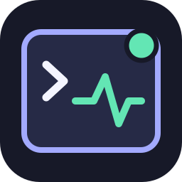

# Codex Discord Presence



Discord Rich Presence para Codex de escritorio y sesiones locales. Muestra cuándo Codex está trabajando, pensando o esperando tu siguiente mensaje; permite añadir el proyecto y el modelo. Node.js 20+, sin dependencias de ejecución ni compilación.

```text
Codex                               ← nombre de tu aplicación de Discord
mi-proyecto                         ← proyecto opcional
gpt-6.1-sol · Usando herramientas    ← modelo y estado
00:12 transcurridos                  ← tiempo desde el inicio de la sesión
```

El nombre principal de la tarjeta lo decide Discord a partir de tu Application ID. Crear una aplicación llamada **Codex** permite mostrar ese nombre; el complemento no puede renombrar una aplicación de otra persona.

## Instalación

Necesitas Discord de escritorio abierto, Node.js 20 o posterior disponible como `node` y Codex con soporte para plugins y hooks locales. Discord en el navegador no proporciona el socket local requerido. En WSL, Codex remoto o un contenedor, el socket de Discord puede estar fuera del entorno y esta versión no instala un puente entre máquinas.

```sh
git clone https://github.com/dizzi1222/codex-discord-presence.git
cd codex-discord-presence
codex plugin marketplace add .
codex plugin add codex-discord-presence@codex-presence
```

También puedes registrar directamente el repositorio:

```sh
codex plugin marketplace add dizzi1222/codex-discord-presence --ref main
codex plugin add codex-discord-presence@codex-presence
```

Abre la gestión de hooks de Codex, revisa `hooks/hooks.json` y marca sus comandos como confiables. Instalar o activar un plugin no concede confianza automáticamente. Abre una sesión nueva después de instalarlo para verificar los eventos desde el inicio.

## Configurar Discord

1. Crea una aplicación en el [Discord Developer Portal](https://discord.com/developers/applications). Puedes llamarla **Codex**.
2. Copia el **Application ID** de General Information. Es un identificador público, no un token. No necesitas crear un bot ni introducir tu contraseña o un token de usuario.
3. Desde la carpeta del repositorio, ejecuta este comando sustituyendo el identificador:

```sh
node src/cli.mjs configure --client-id TU_APPLICATION_ID --show-project true --show-model true --language es
node src/cli.mjs doctor
```

El ejemplo muestra el proyecto y el modelo. Si prefieres ocultarlos:

```sh
node src/cli.mjs configure --show-project false --show-model false
```

Los valores predeterminados del paquete ocultan ambos campos. La configuración del usuario se guarda fuera del repositorio, en el directorio de datos del complemento, y se comparte con su copia instalada. No publiques archivos de configuración personal.

Activa en Discord la opción que permite mostrar tu actividad. Envía una tarea en Codex; los hooks arrancan el proceso local y actualizan la tarjeta. `start` inicia el proceso sin inventar actividad de una sesión:

```sh
node src/cli.mjs start
node src/cli.mjs status
```

## Estados y convivencia

| Evento de Codex | Comportamiento |
| --- | --- |
| `SessionStart` | Registra el comienzo de la sesión. |
| `UserPromptSubmit` | Indica que Codex está pensando. |
| `PreToolUse` | Indica trabajo con una herramienta. |
| `PostToolUse` | Actualiza el estado después de la herramienta. |
| `Stop` / `Interrupt` | Termina el trabajo del turno; retira la tarjeta con el modo predeterminado. |
| `SessionEnd` | Retira la sesión del conjunto de sesiones abiertas. |

Con `--idle-mode clear`, el complemento retira su propia actividad al quedar inactivo. Esto permite convivir con OpenCode, Neovim y MultiPresence, sin controlar la prioridad con la que Discord presenta otras aplicaciones. Para mantener una tarjeta de espera:

```sh
node src/cli.mjs configure --idle-mode show
```

El contador representa tiempo transcurrido desde que el proceso registra el inicio de la sesión. Se conserva al cambiar de estado y reconectar Discord; **no es un contador de tiempo de trabajo acumulado**. Los hooks no ofrecen detección del foco de la ventana. Cambiar de chat no equivale a cerrar una sesión.

## Comandos

| Comando | Uso |
| --- | --- |
| `node src/cli.mjs configure ...` | Guardar Application ID y preferencias. |
| `node src/cli.mjs start` | Iniciar el proceso local. |
| `node src/cli.mjs stop` | Retirar la presencia y detenerlo. |
| `node src/cli.mjs status` | Ver el estado del proceso. |
| `node src/cli.mjs doctor` | Revisar configuración y conectividad. |
| `node src/cli.mjs preview` | Ver una tarjeta de ejemplo con tus preferencias, sin publicarla. |
| `node src/cli.mjs hook` | Entrada JSON interna de los hooks; responde `{}` y termina sin bloquear Codex. |

Preferencias: `--client-id`, `--show-project true|false`, `--show-model true|false`, `--idle-mode clear|show` y `--language es|en`.

`CODEX_DISCORD_CLIENT_ID` permite proporcionar el Application ID mediante el entorno. `CODEX_DISCORD_DATA_DIR` permite elegir otro directorio de datos: debe ser el mismo para el comando de configuración y para los hooks. Las rutas predeterminadas son `%LOCALAPPDATA%/codex-discord-presence` en Windows, `~/Library/Application Support/codex-discord-presence` en macOS y `$XDG_CONFIG_HOME/codex-discord-presence` o `~/.config/codex-discord-presence` en Linux.

## Privacidad y funcionamiento

Los hooks reciben el evento completo de Codex, pero el complemento selecciona los campos necesarios antes de enviarlos al proceso local. No envía prompts, código, argumentos de herramientas ni transcripciones a Discord. Con proyecto visible, muestra únicamente el nombre de la carpeta, no su ruta completa. Con modelo visible, incluye el identificador que proporciona Codex. Discord procesa los campos que decidas mostrar bajo sus propias condiciones.

El proceso mantiene una conexión IPC local con Discord, agrupa las actualizaciones y vuelve a conectarse si Discord se reinicia. No requiere una API key de OpenAI ni un servidor alojado. Los detalles de implementación y las limitaciones se explican en [arquitectura](docs/architecture.md) y [privacidad](docs/privacy.md).

## Si no aparece la presencia

1. Ejecuta `node --version` y `node src/cli.mjs doctor`.
2. Comprueba el Application ID y que Discord de escritorio esté abierto en el mismo sistema.
3. Verifica la configuración de actividad de Discord.
4. Comprueba que el plugin esté activo y que hayas revisado y confiado sus hooks en Codex. Abre una sesión nueva y envía un mensaje.
5. Revisa `node src/cli.mjs status`. En modo `clear`, que la tarjeta desaparezca al terminar el turno es el comportamiento esperado.

Para detenerlo manualmente, usa `node src/cli.mjs stop`. No es necesario cerrar Discord ni desactivar otras aplicaciones de presencia.

## GitHub, workspace y distribución

El repositorio incluye un marketplace de Codex y el paquete portable `plugin.json`, además del manifiesto de compatibilidad. Un ZIP para guardar el plugin en una cuenta debe contener únicamente un plugin y excluir el marketplace, `.git` y los datos del usuario.

Guardar el paquete con Plugin Creator en el workspace crea un plugin privado cuando hay un workspace activo. Para permitir acceso a otros miembros, utiliza los controles de compartir o publicar del workspace con los roles adecuados; la creación privada por sí sola no demuestra acceso para todos. Cada usuario necesita instalar los archivos localmente y configurar su propia aplicación de Discord. Subir el paquete desde la web no despliega el proceso en su ordenador.

Esta distribución en GitHub y workspace no equivale a publicar en el directorio público de OpenAI. La documentación actual reserva los plugins con hooks para instalación manual local y no admite esos hooks en el directorio público.

## Desarrollo

```sh
node --test
```

La prueba del protocolo usa un servidor IPC simulado; no necesita Discord ni credenciales. La validación con Discord real debe hacerse con una aplicación válida y comprobar que Discord confirme `SET_ACTIVITY`. El CI ejecuta las pruebas en Windows y Linux con Node.js 20 y 22.

## Referencias y créditos

Inspirado por la convivencia entre aplicaciones de [opencode-discord-rpc](https://github.com/dizzi1222/opencode-discord-rpc) y por [MultiPresence](https://github.com/dizzi1222/MultiPresence). Implementación independiente.

- [Hooks de Codex](https://learn.chatgpt.com/docs/hooks)
- [Paquetes y marketplaces de plugins](https://developers.openai.com/plugins/build/plugins)
- [Discord RPC](https://docs.discord.com/developers/topics/rpc)

Proyecto comunitario independiente. Licencia [MIT](LICENSE).
